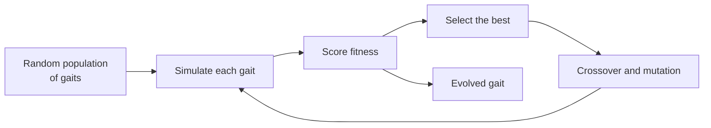

<div align="center">

# 🧬 EvoWalk

### Robots that learn to walk again, on their own.

A **Genetic Algorithm** that evolves robot movement patterns in simulation, so a robot can automatically adapt its gait when its body changes, like losing a limb, **without manual reprogramming**.


[Overview](#-overview) · [How It Works](#-how-it-works) · [Documents](#-project-documents) · [Getting Started](#-getting-started) · [Repository Structure](#-repository-structure)

</div>

---

## 📖 Overview

Most walking robots depend on gaits that were designed by hand for one specific body. If that body changes (a damaged leg, a missing limb), the original gait often stops working and an engineer has to reprogram it.

**EvoWalk** takes a different approach. Instead of hand-coding a new gait, it lets one **evolve**. Candidate movement patterns compete in simulation, the best performers are kept and recombined, and over successive generations the robot discovers a way to move that suits its *new* body.

## ✨ Highlights

- 🧬 **Evolutionary gait search** using a Genetic Algorithm
- 🦿 **Adapts to body changes** such as limb loss
- 🚫 **No manual reprogramming** needed when the robot's condition changes
- 🖥️ **Simulation-based**, so gaits are tested safely before any real hardware is involved

## 🔬 How It Works

The core idea is natural selection applied to movement:



1. **Initialize**: start with a population of candidate movement patterns.
2. **Evaluate**: run each pattern in simulation and measure how well the robot moves.
3. **Select**: keep the best-performing gaits.
4. **Reproduce**: combine and mutate them to create the next generation.
5. **Adapt**: if the robot's body changes (for example, a limb is lost), evolution runs again and finds a new gait that works.

> 💡 *Think of it as the robot "re-learning to walk" through trial and error, the way evolution would, only much faster.*

## 📄 Project Documents

Full details of the project are included in this repository:

| Document | Description |
| :-- | :-- |
| 📊 [`presentation.pdf`](presentation.pdf) | Project presentation slides |
| 📘 [`report.pdf`](report.pdf) | Project report |
| 📗 [`report2.pdf`](report2.pdf) | Additional report |

## 🚀 Getting Started

<!-- TODO: Fill this in once the code is added to the repo. -->

```bash
# 1. Clone the repository
git clone https://github.com/Tanishka-ship-it/EvoWalk-.git
cd EvoWalk-

# 2. Install dependencies
# <add your install command here, e.g. pip install -r requirements.txt>

# 3. Run the simulation
# <add your run command here, e.g. python main.py>
```

## 📁 Repository Structure

```
EvoWalk-/
├── README.md          # You are here
├── presentation.pdf   # Project presentation
├── report.pdf         # Project report
└── report2.pdf        # Additional report
```

## 🛠️ Built With

<!-- TODO: Replace with your actual stack. -->

- Genetic Algorithm (evolutionary computation)
- Robot simulation environment: *add yours here*
- Language: *add yours here*

## 👩‍💻 Author

Made in collaboration with Tanishka, Mansha, Alankrit and Vinamra.

---

<div align="center">

⭐ If you found this project interesting, consider giving it a star!

</div>
